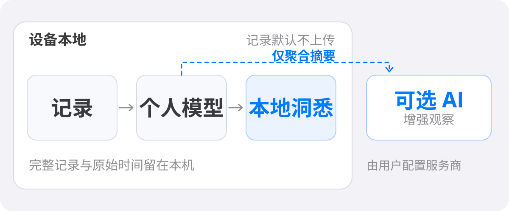

# 观己 · Guanji

> 记录自己的节奏，温和地看见自己的模式。

观己是一款面向私密个人行为的 Android 记录与自我观察 App。它帮助你记下行为频率、发生时段和当时状态，再从自己的长期记录中回看变化；不打分、不与人群常模比较，也不作医学诊断。

**Android · Local-first · 可选 AI · 当前源码 v4.2.12（code 134）· Android 8.0 / API 26+**

<p>
  
</p>

## 记录之后，看见自己的变化

- **轻松记录**：快速记录、计时、补记历史日期，以及编辑和删除。
- **回看节律**：通过首页统计、日历和洞悉页观察频率、时段与发生前状况的变化。
- **建立个人参照**：将近期表现与自己的历史基线比较，而不是套用统一的“正常值”。
- **可选 AI 增强观察**：在本地统计与证据基础上归纳跨维度变化、解释不确定性，并提供可继续观察的问题。
- **日常入口**：桌面小组件、计时通知和可选的温和提醒，让记录保持轻量。

## 隐私边界

观己默认以本机为中心运行，不要求注册账号，也不把私密记录同步到观己自建的用户云端。

| 数据 | 处理方式 |
| --- | --- |
| 个人记录 | 默认保存在自己的设备；可按需开启本地数据加密。 |
| 备份 | 用户可选择 WebDAV；加密备份由用户口令保护。 |
| AI 请求 | 仅在用户配置并使用 AI 时发往所选服务商；内容限于聚合统计与模型证据，不包含单条记录、备注、附件、精确时间或自定义标签原文。 |

AI 输出用于个人观察，不代表因果结论、健康评估或医疗建议。

## 获取与构建

### 安装 APK

前往 [GitHub Releases](https://github.com/photometro/guanji-app/releases) 查看已发布安装包。源码版本与发行版不一定同步；请以具体发行条目的变更说明、签名和 Android 兼容要求为准。

此仓库当前源码最低支持 **Android 8.0（API 26）**。Android 7.x（API 24/25）最后兼容版本为 **v4.2.11（code 133）**；v4.2.12 起要求 API 26，旧系统应继续使用对应兼容版。

### 从源码构建（Windows）

环境：Node.js 18+、JDK 17 或 21、Android SDK，以及可用的 `ANDROID_HOME`。

```powershell
npm ci
npm run build:apk:debug
```

构建并安装到当前在线设备：

```powershell
powershell -NoProfile -ExecutionPolicy Bypass -File tools/build-apk.ps1 -Mode debug -Install
```

项目构建入口会统一处理 Capacitor 同步、Android 资源、签名与 APK 校验；真机验证请使用项目脚本，不要直接调用 `gradlew assemble*`。

仅预览 Web 前端时，可在仓库根目录运行：

```powershell
python -m http.server 8123 --directory www
```

然后打开 <http://localhost:8123>。这只预览 Web 前端，不包含 Android 原生能力。

## 当前工程状态

v4.x 正在分阶段迁移 Android 原生界面。已迁移页面使用 Kotlin 与 Jetpack Compose；部分兼容流程和数据动作仍通过 Capacitor WebView / JavaScript 桥接。WebView 是迁移期的兼容与对照层，不代表最终目标架构。各页面的迁移状态见 [Native Migration Ledger](./docs/native-rewrite/MIGRATION-LEDGER.md)。

主要技术：

- **Android**：Kotlin、Java、Jetpack Compose、Android SDK
- **兼容层**：Capacitor 8、HTML、CSS、JavaScript
- **行为观察**：本地统计、个人基线与可追溯证据；AI 服务为可选项

## 仓库导航

| 路径 | 内容 |
| --- | --- |
| `android/` | Android 工程、原生页面与系统集成 |
| `www/` | WebView 兼容界面及前端逻辑 |
| `docs/` | 数据契约、迁移状态、设计与研究文档 |
| `tools/` | APK 构建与安装入口 |
| `CHANGELOG.md` | 版本变更记录 |
| `THIRD_PARTY_NOTICES.md` | 第三方依赖、字体与许可证说明 |

## 相关说明

- [更新日志](./CHANGELOG.md)
- [原生迁移状态](./docs/native-rewrite/MIGRATION-LEDGER.md)
- [第三方许可与 NOTICE](./THIRD_PARTY_NOTICES.md)

感谢 [Flyme Live Notification Demo](https://github.com/Ruyue-Kinsenka/Flyme-Live-Notification-Demo) 提供实况通知实现参考。
